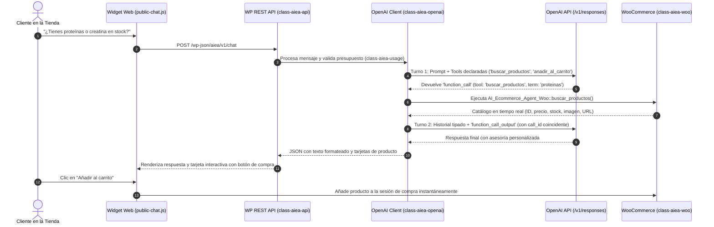

# 🤖 AI Ecommerce Agent for WooCommerce

[](https://wordpress.org)
[](https://woocommerce.com)
[](https://www.php.net)
[](https://platform.openai.com)
[](https://github.com/josramirez972-debug/ai-ecommerce-agent)

> **Plugin comercial y modular para WordPress/WooCommerce que implementa un agente de ventas con Inteligencia Artificial utilizando la Responses API de OpenAI y Function Calling bidireccional en tiempo real.**

---

## 📌 Repositorio Oficial
🔗 **[https://github.com/josramirez972-debug/ai-ecommerce-agent](https://github.com/josramirez972-debug/ai-ecommerce-agent)**

---

## 💡 Descripción general

**AI Ecommerce Agent** resuelve una de las mayores limitaciones de los chatbots convencionales de comercio electrónico: las respuestas genéricas o inventadas (alucinaciones). 

En lugar de depender de textos predefinidos o volcados estáticos (CSV), este plugin conecta a los modelos de lenguaje de OpenAI directamente con la base de datos y la sesión de WooCommerce mediante **Function Calling**. 

Cuando un cliente pregunta por disponibilidad, recomendaciones o precios, el agente consulta activamente el catálogo de productos publicados, procesa existencias reales, genera **tarjetas visuales interactivas** y permite **añadir productos al carrito de compra** directamente desde la conversación.

---

## 🚀 Capacidades Principales

- 🔍 **Búsqueda Tolerante de Catálogo (`buscar_productos`):** Consulta directa al ORM de WooCommerce (`wc_get_products`), con soporte para acrónimos y términos cortos de suplementación (ej. *HMB, CLA, Creatina*).
- 🛒 **Acción de Compra en el Chat (`anadir_al_carrito`):** Permite al modelo o al usuario añadir artículos al carrito de WooCommerce en un clic o mediante lenguaje natural.
- 🖼️ **Tarjetas Visuales Interactivas:** Renderizado dinámico de imagen, nombre, precio formateado, badge de stock y botón directo al carrito/checkout.
- 💬 **Widget Frontend Flotante:** Chat responsivo para clientes de la tienda en JavaScript Vanilla y CSS moderno sin dependencias externas pesadas.
- 🛡️ **Control de Seguridad y Presupuesto de Tokens:** Límite de consumo (`class-aiea-usage.php`) para prevenir abusos de cuota o ataques de denegación de servicio en la API de OpenAI.
- 📚 **Base de Conocimiento y Políticas:** Respuestas contextuales para preguntas frecuentes, envíos, devoluciones y derivación adecuada ante quejas o afirmaciones médicas delicadas.

---

## 🛠️ Stack Tecnológico

| Capa / Componente | Tecnología | Propósito |
| :--- | :--- | :--- |
| **Backend Core** | PHP 7.4+ / OOP | Lógica del plugin estructurada en clases con principio de responsabilidad única (SRP). |
| **Plataforma Ecommerce** | WordPress 6.0+ & WooCommerce | Consumo directo de `wc_get_products`, `WC_Product`, sesiones de carrito y hooks de WordPress. |
| **Motor de Inteligencia Artificial** | OpenAI Responses API (`/v1/responses`) | Modelos `gpt-4.1-mini` y `gpt-4o-mini` con ciclo de Function Calling en 2 turnos con esquemas tipados. |
| **API & Integración** | WordPress REST API (`WP_REST_Server`) | Endpoints seguros con protección CSRF mediante Nonces y control de acceso granular. |
| **Frontend & UI** | JavaScript Vanilla (ES6+) & CSS3 | Widget reactivo asíncrono (`fetch`), tarjetas interactivas y panel de diagnóstico en WP-Admin. |
| **Entorno de Pruebas** | WordPress Studio | Laboratorio de ejecución y pruebas locales sobre la tienda demo (*NUTRIX*). |

---

## 🏗️ Arquitectura del Software

```
ai-ecommerce-agent/
├── ai-ecommerce-agent.php         # Bootstrap del plugin, versionado y registro de hooks
├── assets/
│   ├── css/
│   │   ├── admin.css              # Estilos del panel de configuración administrativa
│   │   └── public-chat.css        # Estilos del widget flotante y tarjetas interactivas
│   └── js/
│       ├── admin.js               # Banco de pruebas y diagnóstico en WP-Admin
│       └── public-chat.js         # Cliente asíncrono para el chat público de la tienda
└── includes/
    ├── class-aiea-admin.php       # Ajustes, configuración de API Key y panel de test
    ├── class-aiea-api.php         # Endpoints REST administrativos y públicos
    ├── class-aiea-knowledge.php   # Base de conocimiento (políticas, FAQs, envíos)
    ├── class-aiea-openai.php      # Cliente de la Responses API y ciclo de Function Calling
    ├── class-aiea-policies.php    # Políticas de derivación y respuestas éticas/médicas
    ├── class-aiea-public.php      # Inyección y carga del widget en el frontend
    ├── class-aiea-session.php     # Gestión de contexto conversacional y sesiones de usuario
    ├── class-aiea-usage.php       # Control de cuota, consumo y presupuesto de tokens
    └── class-aiea-woo.php         # Conector WooCommerce (búsqueda tolerante y gestión de carrito)
```

---

## 🔄 Flujo de Ejecución (Function Calling)



---

## 🔒 Seguridad y Buenas Prácticas

- **Cero Exposición de Credenciales:** La API Key de OpenAI se almacena en la tabla `wp_options` del backend. El campo en el formulario de administración jamás imprime el valor existente en el DOM (`value=""`).
- **Protección CSRF y Permisos:** Endpoints protegidos con nonces de WordPress (`X-WP-Nonce`) y validación de capacidades según el contexto (`manage_options` en admin, sesión sanitizada en público).
- **Sanitización y Escape Riguroso:** Parámetros filtrados con `sanitize_text_field()`, consultas a WooCommerce restringidas a estado `publish`, y textos limpiados con `wp_strip_all_tags()`.
- **Manejo Seguro de Errores:** Errores de API mapeados mediante `WP_Error`, ocultando trazas técnicas o información sensible al cliente final.

---

## 🚀 Instalación y Puesta en Marcha Local

### Requisitos
- WordPress 6.0 o superior.
- WooCommerce activo con productos publicados.
- PHP 7.4+.
- Clave de API de OpenAI válida.

### Pasos
1. Clona el repositorio dentro de tu instalación de WordPress:
   ```bash
   cd wp-content/plugins/
   git clone https://github.com/josramirez972-debug/ai-ecommerce-agent.git
   ```
2. Activa el plugin desde el panel de WordPress (**Plugins → Plugins Instalados**).
3. Dirígete a **AI Ecommerce Agent → Configuración**.
4. Ingresa tu **API Key de OpenAI**, selecciona el modelo deseado (`gpt-4.1-mini`) y guarda los cambios.
5. Visita la tienda para interactuar con el widget de ventas en vivo.

---

## 👨‍💻 Autor

Desarrollado por **José Ramírez** ([@josramirez972-debug](https://github.com/josramirez972-debug)).
